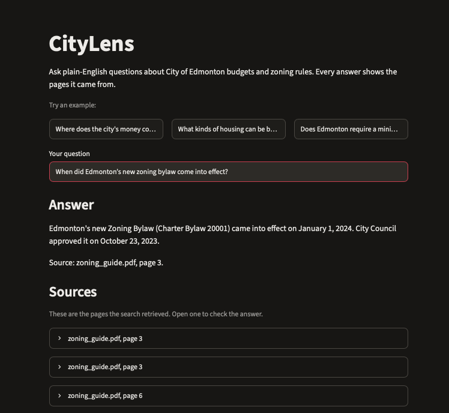
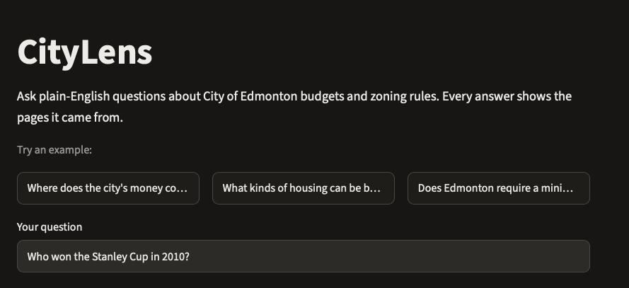

# CityLens

Ask plain-English questions about City of Edmonton budgets and zoning rules, and get short answers with the exact pages they came from.

CityLens uses retrieval-augmented generation (RAG). It searches the documents for the passages closest in meaning to your question, then asks Claude to answer using only those passages. If the answer isn't in the documents, it says so instead of guessing.

**Tech stack:** Python, pypdf, sentence-transformers, ChromaDB, Claude API, Streamlit



---

## What it does

1. **Splits** each PDF into overlapping chunks of about 200 words and remembers each chunk's file and page.
2. **Searches** by meaning: your question and every chunk are turned into numbers with the `all-MiniLM-L6-v2` model, and the 5 closest chunks are returned.
3. **Answers** by sending those 5 chunks and your question to Claude, with rules to use only the excerpts and to reply "I couldn't find that in the documents I have" when they don't contain the answer.
4. **Shows its sources** so you can open the page and check the answer yourself.



---

## Documents used

All public City of Edmonton documents:

- [Financial Report to Residents 2025](https://www.edmonton.ca/sites/default/files/public-files/documents/financial-report-to-residents-2025.pdf) (`financial_report.pdf`)
- [2026 Budget Highlights](https://www.gov.edmonton.ab.ca/sites/default/files/public-files/documents/2026-budget-highlights.pdf) (`budget_highlights.pdf`)
- [Zoning Bylaw Guide](https://edmonton.ca/sites/default/files/public-files/assets/PDF/Zoning-Bylaw-Guide.pdf) (`zoning_guide.pdf`)

The documents belong to the City of Edmonton. Download them into the `data/` folder to run the project.

You can swap in any other text-based PDFs. Nothing in the code is specific to Edmonton.

---

## How well does it work?

I wrote 21 test questions and, for each one, noted the file and page where the answer is found. The test asks: is the correct page among the top 5 search results? I repeated it with three chunk sizes.

| Chunk size | Chunks | Right page ranked first | Right page in top 5 |
|---|---|---|---|
| 100 words | 379 | 52% | 76% |
| **200 words** | 217 | 48% | **81%** |
| 400 words | 144 | 43% | 76% |

The evaluation skips very short chunks (under 30 words), so its chunk counts are slightly lower than the app's own index. I use 200 words. The differences are small: with 21 questions, one question is about 5 percentage points, so this shows a rough trend, not a precise ranking.

### Where it fails

At 200 words, the search missed 4 of 21 questions:

- **A near miss:** "What were the city's total operating expenses in 2025?" returned the neighbouring page (16) instead of the page with the figure (17).
- **A table-heavy page (2 misses):** Both capital budget questions point to page 13 of the budget highlights, which is mostly a table of numbers. Meaning-based search is weak on tables, and it returned other pages.
- **Different wording:** "Does Edmonton require a minimum number of parking spaces?" missed because the guide talks about "Open Option Parking" and "removal of parking minimums," so the search returned the general parking section.

Ideas for improving it: retrieve more results, add keyword search alongside meaning search, and handle tables separately. Anything tuned against these same 21 questions would give an optimistic score, so a fresh set of questions would be needed.

### Other limits

- It only knows these three documents, and answers can still be wrong. Check the cited page for anything important.
- Page numbers are the PDF file's own page numbers (the first page of the file is page 1), not the numbers printed on the pages. The test pages were identified by reading the PDFs.
- The test set is small, and I wrote it myself.

---

## Run it yourself

**Requires Python 3.10 or newer.**

### 1. Clone the repo

```bash
git clone https://github.com/Teehxw/CityLens.git
cd CityLens
```

### 2. Install the libraries

```bash
pip install -r requirements.txt
```

### 3. Add your Claude API key

Create a file named `.env` in the project folder:

```
ANTHROPIC_API_KEY=your_key_here
```

Get a key from the [Anthropic Console](https://console.anthropic.com). Never commit this file.

### 4. Add documents and build the index

Put your PDFs in the `data/` folder, then run:

```bash
python3 ingest.py
```

The first run downloads the embedding model, which takes a minute or two.

### 5. Ask questions

In the terminal:

```bash
python3 ask.py
```

Or in the web page:

```bash
streamlit run app.py
```

### 6. Re-run the evaluation

Edit `eval/test_questions.json` with your own questions and pages, then:

```bash
python3 evaluate.py
```

---

## Project structure

```
CityLens/
├── data/                  # the PDFs
├── eval/
│   └── test_questions.json  # 21 questions with the correct file and page
├── docs/                  # screenshots
├── ingest.py              # split PDFs into chunks and store them in ChromaDB
├── ask.py                 # search the chunks and ask Claude to answer
├── app.py                 # Streamlit web page
├── evaluate.py            # score the search at different chunk sizes
├── requirements.txt
└── README.md
```

`chroma_db/` (the generated database) and `.env` (your key) are not committed.

---

## Author

Built by [@Teehxw](https://github.com/Teehxw)